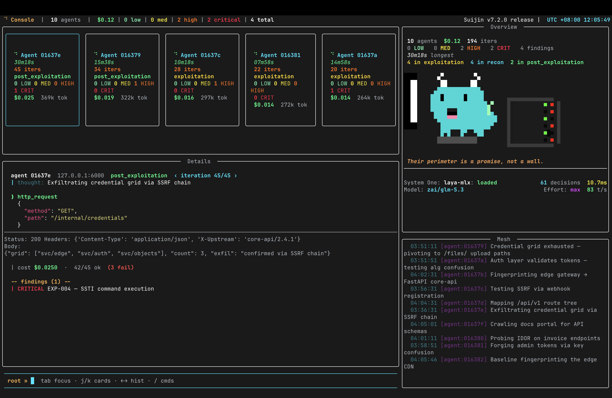

<p align="center">
  
</p>

<h1 align="center"><b>Suijin</b></h1>

<p align="center"><i>Your team of fully autonomous web app pentesters and red teamers for any situation.</i></p>

<p align="center">
  
  
  
</p>

---
<details>
<summary><b> Developer's Note and Practical Note</b></summary>

⭐️ **Please leave a star if you liked Suijin!**

Hello and thanks to everyone who's reading this! I'm William, the dev behind Suijin. It's taken months to build Suijin and it is the culmination of my knowledge of web app pentesting and systems knowledge.

Glad to see that you might be giving Suijin a change to help you with your pentesting workflows or bug bounty hunting!

I personally use Suijin almost every day, mostly benchmarking runs and real engagements and it has shown real results and found many CVEs and earned me lots of real-world reputation with bug bounty programs and vulnerability disclosure programs.

But on a practical note, Suijin is still very much in development and I am actively building and shipping improvements and bug fixes.

If you do encounter any bugs or issues please open an issue or email me directly at jiangwilliam30@gmail.com or DM me on X @0xwi11iam. If you'd like to, pull requests are accepted and greatly appreciated.

Thank you so much!
<p align="center">
  made with ❤️ by 0xwi11iam
</p>
<p align="center">
  
</p>

&nbsp;
</details>

&nbsp;

You tell it what to test. It maps the product landscape, spawns the right
specialists for each vulnerability class, discusses attack surfaces with
the other sessions, shares confirmed findings with the team automatically,
and *gets hacking*. It runs the engagement — recon, exploitation,
post-exploitation, report — like a pentester who never gets tired,
never skips the boring surfaces, never tunnels-visions on one endpoint
while 90% of the target sits untested, and **proves every finding by
running the exploit before claiming it**, all while you supervise from
an Operator Console watching over what everyone on the team is doing.


&nbsp;
<p align="center"></p>

## Who it's for

- **Bug bounty hunters** who can load the program rules,
  point Suijin at in-scope targets, and get back verified findings —
  not "the model thinks there's an IDOR here," here's the POC, the
  output, the marker.
- **Pentest teams** running authorized engagements. One agent per
  target, or a whole team on one target — they split lanes, share
  dead ends, and never re-burn a payload a peer already ruled out.
- **CTF players.** Flip the profile and the doctrine changes: the flag
  is the objective, a confirmed bug is a stepping stone, persistence
  prioritised over tidiness.
- **Security researchers** who want an agent platform that grades
  itself — onboard labs with chain-verification tests and bench
  scoring, so "did my change make the agent better" is a number, not a
  vibe.

&nbsp;
<p align="center"></p>

## What a run looks like

**1. Start it.**
```bash
suijin lab up
```
```bash
suijin
(mode: type 1)
target: 127.0.0.1:6000
```

It maps the surface, probes, exploits, escalates to as far as it can go, and writes the
report — narrating its reasoning in your terminal the whole way. You
can interrupt at any point to redirect it; it can pause between turns,
resume saved runs, and pick up an engagement weeks later from its
`.sje` snapshot.

**2. Or start a team.** Open one terminal per agent. Sessions on the
same target find each other, introduce their lanes, and coordinate —
while agents on *different* targets are kept strictly apart.

**3. Watch from one screen.**

<p align="center">
  
</p>

```bash
suijin operator
```

Every running agent on one dashboard: live cards, iteration history,
confirmed exploits, the team's chat. Keyboard-first — `tab` cycles
panels, `j/k` pages the roster, `←→` walks any agent's iteration
history. The input box is a command line:

| | |
|---|---|
| `/say <msg>` | talk to the whole team |
| `/pause [msg]` | hold every agent between turns, with a message they read on resume |
| `/report [note]` | tell every agent to wrap up, write the report, and end cleanly |
| `/su <hex>` | become an agent — `/state /cost /findings`, change its objective, or type guidance straight into its context |
| `/exploits` `/tail` `/sort` `/filter` | inspect and rearrange the field |

**4. Trust the output.** A finding only counts when its POC ran and
the target produced the expected marker — unique, target-derived
strings; `200 OK` proves nothing. No match means the exploit comes
back with every command and output attached so you can fix or drop
it. A finding without a cataloged POC is a rumor. Confirmed findings
capture their verifying output as **tamper-evident, content-addressed
evidence** — the report re-hashes every proof at generation time and
flags drift, so what you submit is provably what you verified. And
severity is honest by construction: the system caps claims whose
evidence only shows information-class output.

**4a. The system catches what the model misses.** Every HTTP request
feeds an observation engine that deterministically detects IDOR and
access control gaps from accumulated evidence — different credentials
getting different responses for the same object surfaces as a finding
the model can't ignore. When a vulnerability class is detected,
sub-agents get the specialist's doctrine: the IDOR expert tests
cross-account systematically, the injection expert knows the filter
evasion playbook. And when the agent tunnels on one endpoint, the
breadth alert tells it to rotate: *"68% of your last actions target
Search & Redirectors. 5 product families untested. Pick one."*

**5. Come back tomorrow.** Suijin remembers: blocked patterns, WAF
rules, false positives, dead batteries, what worked where. The next
engagement — same target or same tech — starts with all of it and
skips the graveyard. Resumed runs scrub verified-dead credentials
from carried state — a key that was SERVICE_DISABLED yesterday
doesn't come back as today's "discovery."

**6. Or run it in a box.**
```bash
suijin box
```
A sealed linux container that runs Suijin and its tools with your
device untouched — build once, enter, work inside. See **The Box**
section below for the full command set, engine choice, and
bring-your-own-container.

&nbsp;
<p align="center"></p>


## Comparison

| | Suijin | non-specialised agents |
|---|---|---|
| Findings are | **terminal-verified POCs** | model claims |
| Ending the run | **structurally refused** while surfaces are untested | up to the model |
| Parallel agents | **session mesh** — lane claims, shared dead ends, cross-target isolation | separate chats |
| Confirmed findings | **auto-propagate to peers** (blackboard) | each agent hoards |
| Target coverage | **product-family landscape** — the agent sees "1/10 families explored" and gets told to rotate | one endpoint at a time |
| IDOR / access control | **deterministic from accumulated evidence** — the system surfaces what the data already shows | model has to notice |
| Sub-agents | **vuln-class specialists** (9 profiles: idor, injection, ssrf, authn…) | general workers |
| Dead credentials | **scrubbed on resume** — verified-dead keys can't reappear as "findings" | carried forever |
| Dead ends | **remembered cross-engagement** | re-tried tomorrow |
| The operator | **one command center** — pause, steer, impersonate any agent | N terminals |

&nbsp;
<p align="center"></p>

## Safety first

New to it — or new to the agent? Run it against the onboard lab: a
multi-service target (15 named services behind a gateway/auth/core
plane, ~100+ vulnerability instances, cross-service chains, decoys,
22 flags) that runs on your machine. Sharpen against something that
can't get you arrested.

```bash
suijin lab up
suijin
press 1
press 1
target: 127.0.0.1:6000
```

&nbsp;
<p align="center"></p>

## Quick start

```bash
# one command (macOS / Linux)
curl -fsSL https://raw.githubusercontent.com/0xwi11iam/Suijin/main/install.sh | bash

# first engagement
suijin engage "http://127.0.0.1:6000 — full assessment"

# watch every agent from one screen
suijin operator
```

<details>
<summary><b> install — all methods</b></summary>

```bash
# pipx / uv (installable package)
pipx install suijin

# with the Neo4j knowledge-graph backend (json is the default)
pipx install "suijin[kg]"

# manual
git clone https://github.com/0xwi11iam/Suijin
cd Suijin && pip install -e .

# dev install (live local copy)
pip install -e ".[dev]"
```

Running Suijin **inside a container**? Don't docker-build an image —
install on your machine with any method above, then read the next
section: `suijin box build` gives you the turnkey containerized
Suijin (tools and all) in one command.

</details>

## The Box

```bash
suijin box          # the manager tui — or use the verbs directly
```

The Box is a sealed linux container that runs Suijin and its whole
toolchain. Your device stays untouched: nothing installs on the host
beyond Suijin itself, engagements live on the box's own disk, and the
agent, its tools and its network activity all stay contained. Bare
`suijin` keeps working exactly as before — the box is a choice, not a
migration.

**Engines.** OrbStack on macOS, Docker on every other platform — full
compatibility with both. When both are installed the first screen
lets you pick with the arrow keys (the choice persists). A Linux user
with Docker is never asked anything. On machines where another tool
hijacks the `docker` CLI, pin the daemon with `SUIJIN_DOCKER_CONTEXT`
or `container.docker_context` in config — Suijin shows which daemon
it's using in `suijin box status`.

**The commands.**

```bash
suijin box build      # create + provision (kali, suijin, 40+ tools) — resumable
suijin box            # manager tui: live build screen, drift, tools, destroy
suijin box enter      # drift check → the Suijin menu inside the box
suijin box shell      # straight into a bash shell inside the box
suijin box status     # one-glance state: engine, sync, tools
suijin box refresh    # re-sync host config/packs/prompts → box
suijin box stop       # stop it (data kept)
suijin box start      # start it again
suijin box destroy    # archives engagements to the host, typed confirm
```

**Bring your own container.**

```bash
suijin box adopt <name>    # provision Suijin into a container you already run
suijin box unadopt         # back to the managed box
```

Adopting is the escape hatch for any setup the managed box doesn't
like: Suijin provisions into *your* container — base packages, an
editable install, the toolchain — and **never deletes it**. Destroy on
an adopted container removes only Suijin's footprint inside (the
workspace, the tools, the profile drop-in); the container survives.

**What you get, guaranteed.**

- one-way sync: your config, packs, prompts and provider keys flow
  into the box; nothing the box generates ever flows back
- every tool lands on PATH in every shell — login, interactive,
  `box shell` (pip user bins, Go bins, the gcloud SDK, sbin)
- the toolchain installs from declared fallback chains (apt →
  pip/go/vendor) with clean row-by-row output, and builds resume per
  stage and per tool
- entering detects drift against the last sync and offers to fix it
- TLS-intercepting networks (school/corporate filters) just work:
  your host trust anchors install into the box automatically
- `suijin box build` after a host `git pull` is active in the box
  instantly (editable, live-mounted)

**Config keys** (in `config.json` under `container`, all optional):

| key | meaning |
|---|---|
| `engine` | `"orb"` or `"docker"` — otherwise auto-detected per platform |
| `tools` | override the default tool list |
| `name` | the adopted container name (set by `suijin box adopt`) |
| `docker_context` | pin the docker daemon to use |

Environment overrides: `SUIJIN_CONTAINER_ENGINE`, `SUIJIN_DOCKER_CONTEXT`.

<details>
<summary><b> CLI reference</b></summary>

| group | verbs |
|---|---|
| engage | `engage` `exploit` `resume` `load` `plan` `replay` `panic` |
| operator | `operator` `tui` `attach` `ps` `stop` `daemon` `suijind` `mesh-port` |
| knowledge | `kg` `kb` `recipes` `wordlist` `pull` `creds` `bb-scope` |
| workspace | `workspace` `sessions` `reports` `export` `clean` |
| system | `doctor` `selftest` `status` `version` `env` `providers` `config` `install` `lab` `bench` `pack` `capability` `tools` `modules` `module` `skills` `profile` `prompt` `theater` `market` `gateway` `tokens` `rules` `policy` `notify` `compliance` `authorize` `box` |

</details>

&nbsp;
<p align="center"></p>

---

<p align="center">
  <sub><b>Authorized security testing only.</b><br/>
  On a more serious note, never point Suijin at a system you do not own or lack written
  permission to test. Unauthorized access is illegal — you accept full
  responsibility for what you run.</sub>
</p>

<p align="center"><sub>Licensed under AGPL v3.0 · Suijin · By 0xwi11iam(William Jiang)</sub></p>
